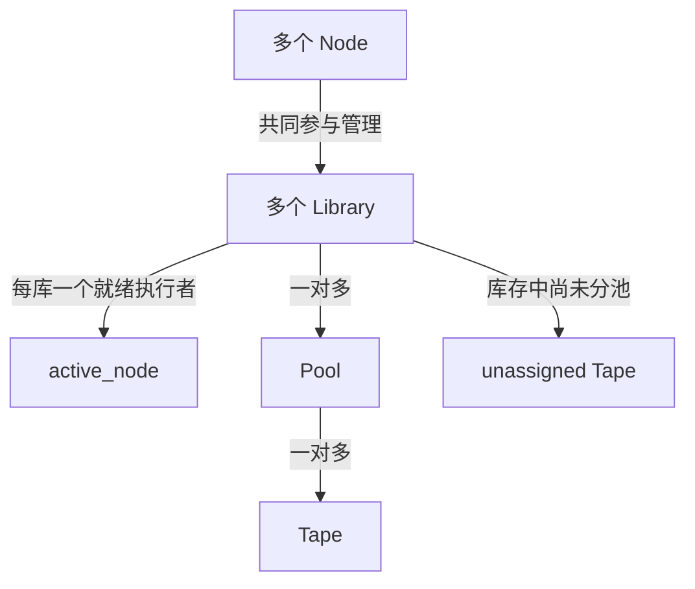

# 带库运维管理模型规范

运行时必须与 GPFS/EE 解耦：FDB 是目录、归属、异步任务及通知的权威；S3、FUSE、导入与已分配卷刷新直接使用本项目的 SCSI/LTFS 链路。`-P` 指池内逻辑路径，不能要求 GPFS 挂载、DMAPI 或 HSM stub。真实 EE 环境只用于对照研究，具体边界及独立运行验收见 [ADR：GPFS 独立运行时](adr/0002-gpfs-independent-runtime.md)。

状态：用户确认，2026-11-04。指定的 13 项 CLI/HTTP 已实现并完成限定路径的真实带库验收，详见[现场报告](../.scratch/ltfs-ha/reports/management-model-physical-20261104.md)。本文件规定首版 CLI、HTTP 管理接口、持久化结构和验收行为；未覆盖的边界不得扩大为已验收。领域词汇见 [CONTEXT.md](../CONTEXT.md)，决策见 [ADR](adr/0001-library-pool-tape-management.md)。

## 关系和身份



- Library 用真实 changer serial 标识，绑定该库驱动器；每库独立管理、隔离、接管及处理任务。
- Pool 用不可复用 UUID 标识，只属于一个 Library；库内名称唯一，可变更名称。每池拥有独立文件命名空间。
- Tape 的运维选择使用库内条码；介质文件系统身份使用实际 LTFS volume UUID，不能互相替代。每盘数据带同时最多属于一个 Pool。
- 物理库存包含未分池数据带和清洗带。库级 `tape list` 显示它们；池级列表只显示该池成员。清洗带不允许索引导入。
- 不提供 nodegroup 实体、默认 G0、分组接口、池/驱动器分组属性或分组调度条件。

## 节点与执行权

`library show` 包含 `nodes` 和 `active_node`。`nodes` 是该库参与节点的清单，区分配置身份与实际观测，不凭配置推断节点健康。`active_node` 是已完成该库接管并达到就绪状态的设备 owner；没有就绪 owner 时返回 null，不能把候选、优选目标或 Raft Leader 当作 active_node。

一个 Node 可以管理多个 Library；一个 Library 可以由多个 Node 参与管理。每库同时最多一个就绪设备 owner，不同库可有不同 owner。节点足够且路径健康时尽量分散各库的 active_node；候选不足时允许集中，不能为分散而让可服务的库不可用。健康 owner 的调整需稳定等待、空闲安全点和尽量少迁移，避免持续抖动；故障接管不等待均衡。HTTP 网关 VIP 的持有者不计作带库负载。

设备任务开始前先提交当前实例/轮次的 busy 证明，结束后报告 idle；健康迁移须在同一共识状态机消费仍有效的 idle 序号，不能用查询时的旧空闲观测绕过进行中的设备任务。所有真实转移继续执行多数派许可、接管轮次、设备 PR/fencing、恢复和就绪确认。调度目标改变不等于设备所有权已经改变；安全性优先于均衡。

## 运维 CLI

```sh
ltfsctl -e HOST:7401 library list --json
ltfsctl -e HOST:7401 library show -l LIBRARY --json
ltfsctl -e HOST:7401 library rescan -l LIBRARY --request rescan.json
ltfsctl -e HOST:7401 pool create ARCHIVE -l LIBRARY --request create-pool.json
ltfsctl -e HOST:7401 pool list -l LIBRARY --json
ltfsctl -e HOST:7401 pool show ARCHIVE -l LIBRARY
ltfsctl -e HOST:7401 pool delete EMPTY_POOL -l LIBRARY --request delete-pool.json
ltfsctl -e HOST:7401 tape list -l LIBRARY --json
ltfsctl -e HOST:7401 tape list -l LIBRARY -p ARCHIVE --json
ltfsctl -e HOST:7401 tape import BARCODE -l LIBRARY -p ARCHIVE --request import.json
ltfsctl -e HOST:7401 tape assign EMPTY_BARCODE -l LIBRARY -p ARCHIVE --yes --request assign.json
ltfsctl -e HOST:7401 tape validate BARCODE -l LIBRARY -p ARCHIVE --request validate.json
ltfsctl -e HOST:7401 tape unassign EMPTY_BARCODE -l LIBRARY -p ARCHIVE --request unassign.json
ltfsctl -e HOST:7401 tape move EMPTY_BARCODE -l LIBRARY -L ieslot --request move-ie.json
ltfsctl -e HOST:7401 tape move EMPTY_BARCODE -l LIBRARY -L homeslot --request move-home.json
ltfsctl -e HOST:7401 task show NAMESPACE:LIBRARY_SERIAL:EPOCH:OPERATION -l LIBRARY
```

多库环境的池操作与导入必须明确选库。池可按库内名称或 UUID 选择，但原请求固定 UUID、namespace 和必要 revision。创建池先保存稳定 UUID；响应丢失后 `pool create --request FILE` 使用原文件恢复，不创建替代 UUID。删除和修改也先保存原请求。移除重复的 `fdb pool`、`fdb tape` 及节点组入口，不保留兼容别名。

## 首版命令覆盖清单

下列命令属于用户要求的交付及真实带库验收范围。命令存在于帮助中不算完成，必须有同一应用服务支持的 HTTP 接口和可复查结果。

| 命令 | 核心行为 |
|---|---|
| library list | 列出已配置带库 |
| library rescan | 异步刷新指定库的真实库存，失败不覆盖成功观测为空 |
| library show | 库身份、设备观测、nodes、active_node |
| pool create | 创建指定库内的逻辑池 |
| pool delete | 按原修订号删除无引用空池 |
| pool list | 分页列出库内池，CLI 自动续页 |
| pool show | 按库内名称或 UUID 查询池 |
| tape list | 库库存或指定池成员；不隐式读每卷 index |
| tape import | 异步导入已有文件索引到 FDB，正文留带 |
| tape move | 异步移动到 homeslot/ieslot，核验实际位置，不隐式改池 |
| tape assign | 异步检查/初始化介质并入池；格式化须显式确认，有文件默认拒绝，force 才允许覆盖 |
| tape unassign | FDB 证明无有效副本和在途依赖后解除归属，保留介质内容 |
| tape validate | 异步核验标签、索引及一致性并保存真实诊断，不自动修复或导入 |
| tape offline | 异步设置离线及持久说明；不隐式退带 |
| tape online | 实际装带读回标签与索引，核验 FDB 原卷 head 后才解除离线 |
| tape set | 按原归属和修订号设置 blacklisted、online=false、offline_message |

省略 -l 的 rescan 为每个已配置库建立独立任务；指定 -l 只扫描该库。assign 初始化有文件的带须额外 -f/--force-format；默认拒绝覆盖。所有设备命令恢复时仅传 --request 原文件，不附加新的条码、格式化或目的位置参数。

耗时设备命令先持久登记原任务再开始 I/O；CLI/HTTP 返回原 task_id，以 task list/show 查询阶段和终态。多盘请求逐盘持久保存结果，部分成功不能伪装成整个批次的物理原子回滚。`assign`、`import`、`unassign` 和机械 `move` 的区别及 EE 版本依据见 [生命周期研究](research/ee-management-lifecycle.md)。

运维任务按物理 Library 互斥，同库跨池也适用，不同库可并行。rescan、reclaim、unassign 与 tape set/offline 的启动检查由共享 FDB 后端执行；查询和排队不等于取得执行权。原任务及其占用必须一起恢复，不能因超时、断线或 HA 自动解锁。EE 参考清单、参数互斥及当前原生 reclaim 的未开放边界见 [管理命令互斥](management-task-exclusion.md)。

## HTTP 层级

以下均为运维管理接口；文件下载、上传及 S3 是独立的数据接口。

| 方法 | 路径 | 行为 |
|---|---|---|
| GET | `/admin/libraries` | 列带库 |
| GET | `/libraries/{library}/admin/library` | 含 nodes/active_node 的库详情 |
| POST | `/libraries/{library}/admin/library/rescan` | 异步库存刷新 |
| GET | `/libraries/{library}/admin/pools` | 库内池分页 |
| POST | `/libraries/{library}/admin/pools` | 按原请求固定 UUID 幂等创建池 |
| GET | `/libraries/{library}/admin/pools/{pool}` | 池详情 |
| PATCH | `/libraries/{library}/admin/pools/{pool}` | 按原修订号提交池修改任务 |
| DELETE | `/libraries/{library}/admin/pools/{pool}` | 提交空池删除任务 |
| GET | `/libraries/{library}/admin/tapes` | 库库存，包括 unassigned 与清洗带 |
| GET | `/libraries/{library}/admin/tapes/{barcode}` | 库内介质详情 |
| GET | `/libraries/{library}/admin/pools/{pool}/tapes` | 仅该池成员分页 |
| GET | `/libraries/{library}/admin/pools/{pool}/tapes/{barcode}` | 校验归属后返回详情 |
| POST | `/libraries/{library}/admin/pools/{pool}/tapes/{barcode}/import` | 异步索引导入 |
| POST | `/libraries/{library}/admin/pools/{pool}/tapes/{barcode}/assign` | 显式确认后的介质初始化/入池 |
| POST | `/libraries/{library}/admin/pools/{pool}/tapes/{barcode}/unassign` | 无依赖证明后解除归属 |
| POST | `/libraries/{library}/admin/pools/{pool}/tapes/{barcode}/validate` | 核验池内介质 |
| POST | `/libraries/{library}/admin/pools/{pool}/tapes/{barcode}/offline` | 提交 online=false 及离线说明 |
| POST | `/libraries/{library}/admin/pools/{pool}/tapes/{barcode}/online` | 提交实带核验上线 |
| POST | `/libraries/{library}/admin/pools/{pool}/tapes/{barcode}/set` | 提交磁带属性变更 |
| POST | `/libraries/{library}/admin/pools/{pool}/tapes/{barcode}/move` | 校验成员及离线条件后移动 |
| POST | `/libraries/{library}/admin/tapes/{barcode}/move` | 移动未分池库存介质 |
| GET | `/libraries/{library}/admin/tasks` | 持久任务分页 |
| GET | `/libraries/{library}/admin/tasks/{epoch}/{operation}` | 原任务状态和进度 |
| POST | `/libraries/{library}/admin/tasks/{epoch}/{operation}/cancel` | 请求原任务安全取消 |

所有带库作用域请求携带 `x-tapers-catalog-namespace: NAMESPACE_UUID`。创建池正文是固定 `version=1`、`id`、`name`、`file_limit`、`created_at_millis` 和 `policy` 的完整规范 JSON；修改、删除和导入正文采用预先准备并保存的完整管理请求。URL 与原请求的 Library、Pool、条码和操作必须一致；跨库、跨池和过期 namespace 均拒绝。metadata-readonly 不执行管理变更；owner-readonly 的文件内容只读，仍可管理池及执行显式 rescan、assign、move。其他生命周期任务及文件写入需要 owner-writable。分页游标绑定 Library、namespace 及适用的 Pool，不能跨作用域复用。

空池删除必须同时满足目录为空、无磁带归属、无接入屏障及在途写入；损坏或状态未知时拒绝。删除仅撤销逻辑池，保留退役 UUID 约束，不隐式卸带、解除归属、擦除或格式化。

### 介质安全边界

assign 使用原请求固定的待创建 volume UUID。格式化前持久记录操作阶段与授权，完成后重新核验标签和索引，最后才发布 FDB 归属。未知探测或 mount 错误不是“空白”；格式化开始后的错误必须保留已写或结果未知的证据，不能回滚数据库后声称介质未变。原任务接续不能生成新的 UUID 或绕过确认门槛。

move 每次实际移动前核验条码、原位置、home、address map、空闲目的位置和所有权；去 I/E 仅允许未分池或已离线成员。驱动器中的介质先安全关闭和正常退带，再移动并核对库存。超时或接管后先观察真实位置，不能盲重放 MOVE 或自动逆向补偿。

普通 S3/FUSE 请求的自动装卸与 import 同样受 FDB 原机械检查点约束：先固定条码、卷、驱动器和地址，再持久记录本次命令授权。命令回执未知后，后续请求与接管节点只能读取库存或 TUR 来核实原后置条件，不能换目标或再次发送原 LOAD、UNLOAD、MOVE。尚不能确认时保留原占用和健康 owner，普通数据接口保持不可用；取消也须先结清原机械结果。FDB 不可达或原结果未结清时，计划停机不卸带、不释放相关设备预约。池实际挂载数已超过新上限时，导入保持等待，不会在一次导入中隐式连续淘汰多盘磁带。此时原任务仍持有带库和池的操作占用，普通 idle 卸带和同池上限修改不能解除等待。应先用 `task cancel TASK_ID` 请求取消，再用 `task show TASK_ID` 确认原任务已取消且回滚完成，之后才能卸带或调整上限，并显式提交新的导入请求。取消受理回执不等于回滚完成；机械结果仍未知时须保留原任务，不能清除占用或改发新请求。

unassign 的证明覆盖卷反向副本索引、已发布上传 claim、历史有效副本、在途写入及维护占用；不能仅数当前路径，也不能用临时下载声称完成 resident 恢复。证明与解除归属之间须阻止新引用进入。validate 只声明实际执行的标签/index/结构核验，不把它说成全文件正文校验；SCSI 诊断保留原始状态与 sense。

节点物理任务对介质的占用按卷 UUID 全局唯一，单节点修改和多卷 rename 共用这一占用，不随 namespace 改变而隔离。占用记录保留原库、namespace、请求和物理尝试身份；旧作用域的占用也会阻止新任务、unassign 和 reclaim 清理。全局零引用检查覆盖所有扫描和 namespace 的保留副本、在途写入、恢复、导入与节点占用；负向检查参与 FDB 事务冲突检测。这仍是目录证明，格式化还必须有完整的实带源索引逐对象证明。

回收源对象清单从实际核验的当前 Full/增量重放视图生成，包含根目录、空目录、零长度文件、符号链接及 EE 内部数据对象，不使用导入后的逻辑候选列表代替。未知索引字段、截断历史或未关闭文件不能形成完整清单。内部清单按页封存在 FDB，绑定原卷、扫描、索引与任务，owner 接任先领取原父任务再接续；未完成页不作为完整结果。

清单封存只证明源中有哪些对象，不证明迁移完成，不退休有效引用，也不授权擦除。每个对象仍须有目的端实际验证或明确退休依据，并通过全局零引用检查。当前这些回收内核尚未构成可调用的完整 reclaim 命令。

回收复制子任务固定首次文件请求代次、完整源/目标身份与准入名额，并在同一事务建立历史保留引用。其持久身份不随文件窗口轮换或父池屏障释放而消失；旧子任务不能退化为普通上传。Q 写前预约仍在挂载恢复完成后登记，复用首次保留的准入名额，不重复计费。首次目的端实读验证必须读取原上传终态，在回收账本中封存完整证明后才释放本任务的历史引用；后续普通请求结果清理不会删除回收所需证明。取消和最终释放仍须先结清原子任务，不能套用零子任务释放路径。

复制准入还必须携带实际源读取证明。执行节点在核验当前卷头、原文件与完整源清单后，读取源正文并从返回的匿名暂存文件计算 SHA-256；原索引没有记录摘要时也采用同一流程。证明将原数据 UID、完整节点摘要、精确 extent、卷头和原副本绑定到复制子请求。EE 别名使用其内部数据对象 UID，不把链接 UID 当成数据来源；目录和原生符号链接不能走正文复制路径。该证明由执行节点内部生成，不接受 HTTP 提交的证明字段。

内部数据迁移账本将源实读证明、完整源清单中的原对象、目标实读与精确退休回执绑定，在同一 FDB 事务中退休原副本并封存迁移证明、推进计数。按源数据 UID 去重统计，每个复制子任务保留独立目的回执，因此多个 EE 别名共享数据时不会重复计算原数据量。依赖失败、证明冲突和接管重放都使用原父子身份；普通请求结果清理不删除这份独立证明。该计数只涵盖正文迁移，原生链接、目录、根属性及别名节点的元数据仍须另行覆盖，不能据此格式化源带。

内部文件元数据证明从当前完整源索引定位原文件节点或 EE 别名节点，用目的实际读回及当前完整目的索引核对 UID、路径、extent 和 FDB 已发布属性，再核对时间、只读标志、所有用户扩展属性及正文摘要。UID 和受管理版本按搬迁规则更新；已有 MD5 不得丢失。按原逻辑节点 UID 单独记录覆盖，正文、元数据证明与精确源退休在同一事务中提交。结果丢失或接管后，可从 FDB 复核原证明并恢复，无需依赖内存对象或再次读带。两个 EE 别名分别计元数据覆盖，共用的原正文只计一次；这不覆盖 EE 内部 blob 的元数据、空目录、根属性或原生链接，也不授予格式化许可。

内部原始文件元数据计划在准备时固定 UID、路径、原属性与本卷已核验正文 extent 的指纹，并取得原父与全局卷占用。写前须在同一 FDB 事务重核原证明、目标卷头、物理文件计数、配额及介质状态，将 Prepared 变为 Writing。并发或重复调用仅有一次新转换；已为 Writing 或提交回执未确认后的重试返回原记录及“须观察”结果，不能按新请求重放写入。Writing 表示可能已执行，准备阶段关闭必须拒绝且保留原占用；接任先领取原父，再领取原元数据任务，仍保留 Writing 和原计划。原回执与当前阶段冲突时拒绝，不回退或补建记录。这只是目录中的持久准入状态，设备执行、逐 CDB 守卫与未知结果的实带观察尚须接线，不能用该结果直接授权 I/O 或源带格式化。

固定计划还保留原目标卷完整对象树的摘要与计数，逐对象覆盖根、目录、链接、文件属性及 extent。计算复用已经核验的磁盘索引视图，按路径字节序流式进行。当前介质结果的只读判定只接受完整、未截断的当前 DP 来源：原卷头及原树完全一致时标为 Unchanged；计划同时固定原目标构造及其完整 delta 前驱链身份。下一代 delta 的实读链必须精确延续该身份；下一代 Full 除连接原前驱位置，还必须另外实读原历史构造及其所需链，逐项核对 SHA 和身份，缺少该证明则拒绝。下一代构造仅增加固定 UID/路径/节点，其他对象及计数保持原样，才标为 Committed。历史来源、跳代、其他卷、正文节点变化或无关树变化均拒绝。判定结果仅描述捕获时已核验的索引，不是写入、重放、释放占用或擦除许可。内部保存接口只向原 Writing 任务记录该快照：Prepared 或旧 owner 拒绝，重复保存返回原记录，允许从 Unchanged 推进为 Committed，已为 Committed 后禁止回退或改变。HA 领取仍保留原计划、快照及所有占用；它不发布活动卷头、增加文件计数、完成任务或释放资源。观测记录使用带完整性 SHA-256 校验的私有固定长度编码并绑定原计划，不能从外部反序列化成证据。持久快照与本轮设备实读证明分开：快照只记录事实，发布要求设备 actor 重新捕获、核验并返回的原 owner/尝试证明。首版任务记录使用 v5，含稳定尝试 UUID、首次尝试/前身、原扫描及执行上下文身份，无旧格式兼容。

独立元数据执行原语只接收由串行设备执行线程按原目标归属选中并装入的驱动器，不负责换带、fencing、尾部修复或格式化。设备必须绑定同一 Permission 实例和同一代次的最内层守卫，原始设备或绑定其他许可实例时在准入和设备访问前拒绝；等待 FDB 或 PR 查询期间失权时，最内层守卫仍须拦住下一条媒体 CDB。首次 Prepared→Writing 准入后，重新捕获实际目标，核对原源节点、原目标完整树和固定新节点，再提交索引；每条 CDB 前后核对原任务、route/owner、多数派许可和 PR，首次执行还在同一 FDB 读版本重核原输入、卷头、计数、配额与可写监控状态。命令结果未知或提交报错时停止本次执行，不就地重试；Writing 重入只重新采集当前介质与必要历史构造并保存快照，即使观察仍为 Unchanged 也不再次写入。DP 完整但 IP 写入失败可由新采集识别；截断尾部仍阻塞，不自动修复。捕获与对象核验采用流式视图；提交挂载使用同一 RecoveryBudget 完整审计，但仍物化索引树，当前未提供全程恒定内存提交。该原语返回保留占用的 Writing 快照；已确认固定节点实际提交时另返回不能反序列化的本轮实读证明。已发布任务重放只查询原结果，不访问设备；未接完整父任务及自动恢复流程，公开原生 reclaim 入口仍拒绝执行。

元数据结果发布在一个 FDB 事务中核对原父任务、owner、稳定尝试、源/目标证明、原扫描、旧活动卷头和物理计数，要求新代次历史、计数及发布回执槽均为空，然后一起写入新活动卷头/历史/计数、独立发布回执和原任务 Committed 终态，仅清除与该尝试完全一致的库内与全局卷占用。并发或丢失回执后的重试只返回原发布，不重复计数，也不清除后续任务占用。改变原请求、缺失或损坏回执及不明结果槽均拒绝，不自动修复。已实际提交的结果不因后续配额或可写策略改变而丢失，但首次设备写入仍须通过当前策略。独立回执绑定原库/namespace/池、扫描、固定计划、完整观察和发布 owner，并校验完整性；活动卷历史读取不依赖可清理的原父任务/清单行。HA 可按原身份查询已发布结果，旧 owner 的实读证明不能重新绑定接任 owner。该事务只完成一个原始文件元数据物理尝试，不代表全源对象覆盖、父任务完成或格式化许可；尚未通过真实 B 库验收。

Writing 的未写关闭另要求 actor 本轮实读证明：DP 紧邻 EOD、原完整树和卷头未变，且 IP 与 DP 代次一致。缺失、超前或落后的 IP 不能生成关闭证明；保存的 Unchanged 快照也不能恢复成该证明。关闭事务核对原请求、owner/尝试/扫描和精确自有占用、原活动卷头/计数、无恢复标记及下一代历史/计数/发布结果槽均空，才将原任务改为 Closed 并释放自己的两项占用；不更新卷头、计数或源覆盖。并发和回执丢失后的同身份重试返回原 Closed，不能释放其他任务后续取得的占用，旧 owner 证明不可重绑。未写关闭只结清原尝试；受控尾部恢复、关闭后的显式新尝试和完整父任务尚待接线，未通过真实带库验收。

每次原始文件元数据物理尝试按父任务、源 UID 和尝试 UUID 单独保存在 FDB；最新索引只指向当前尝试。首次准备重放始终返回原首次记录，不能解释成后来的重试。显式新尝试只接受已关闭的原尝试及仍未改变的同一固定计划、目标卷头/扫描/计数，重新检查当前可写策略及卷空闲后创建不同 UUID 的 Prepared；Writing 或结果未知不能借此重放。原记录不覆盖，首次/前身身份不改变，原关闭到唯一后继的边与新记录/最新索引/自有占用同事务保存。重复旧重试始终返回那个原后继，即使已出现第三次尝试；后继边或记录缺失、冲突时拒绝，不重新生成请求。

父任务的有界元数据检查点绑定最后尝试身份及完整任务摘要，检查点自身以父上下文和 SHA-256 校验；阶段、owner、已保存观察及固定计划均受约束。准备、准入、观察、领取与终态在同一 FDB 事务更新相应原记录和当前检查点。恢复发现交叉核对原任务、最新索引、RA、全局卷占用和扫描；丢失、损坏或回退均拒绝，不能当作没有待恢复任务，也不自动修复。检查使用固定数量点读与至多三个取首行的前缀探测，不遍历全部源对象或无限历史链。占用中的尝试还要求当前检查点精确相等；目录记录自身仍不授设备执行或格式化权。

历史可按源 UID/原尝试 UUID 或原句柄恢复查询；接任领取须明确指向发现的原句柄，不能让最新尝试替代它。历史终态保持可读且不清除后续任务占用，领取旧终态只更新其 owner，不替换其他当前检查点；旧 owner 的实读证明仍不能转成接任许可。新的后继已发布时，活动卷历史使用独立回执，不依赖旧尝试、父检查点或源清单行。以上内核尚未接完整父流程、同代 IP/截断尾部恢复、新 donor 实读及全源覆盖，未通过真实带库验收；公开原生 reclaim 入口和源格式化继续封闭。

执行恢复上下文固定原 ReclaimFile、子请求 epoch 和完整请求指纹；完整原子请求复用已封存 child，不另建请求副本。首次准备随原任务保存，后继原样继承，阶段、观察及 owner 变化不能改变这些身份。接任先领取原父与原尝试，再在同一 FDB 读版本按原 operation 点读 child、核对上下文并重核原源/正文/目的实读与退休账本、固定计划输入；不依赖命名空间扫描器的 current，也不遍历所有子任务。缺失、损坏或改变的原请求/证明拒绝且不修复记录，旧 owner 句柄拒绝；Closed/Committed 仅走原历史查询。返回的文件和请求只是恢复参数，设备访问仍要求 actor 的本轮 Permission、PR 和原任务逐 CDB 守卫。它尚未接 Serving 前完整恢复，未通过真实带库验收。

内部取消流程区分“已取得准入名额但尚未登记写预约”和“已执行或结果未知”。前者须同事务核对原父子身份、当前所有权、原代次保留引用，以及原写预约、升级意图和批次均未登记，才可释放原名额一次、保存取消终态并清除自己的历史引用。独立取消回执保留在 FDB，普通请求结果清理后仍可恢复，代次轮换和 HA 不得另建子请求。后者继续等待介质恢复与原提交结清，不能因超时或 FDB 暂时不可达便清掉占用。单个子任务取消不释放父任务的池写入屏障。 已登记写预约的子任务，须先通过原介质恢复流程确认取消并保存原终态；内部账本随后只封存该终态、清自己的历史引用，不再次释放名额。父任务恢复按原子请求记录有界分页，已清写预约或已清普通结果的子任务仍可被列出；这两个内部步骤仍须由完整父任务执行流程接线，不能据此认为公开回收已可用。


## 异步索引导入

首次接入用 `library list/show` 选库、`tape list/show` 选未分池带，创建或选择该库的 Pool，再提交 `tape import`。已分池条码在原 Pool 内运行同一命令，刷新原卷索引和目录映射。列表只读缓存观测，不扫描每卷 index；提交及设备操作前重新核验真实状态与当前所有权。

- CLI 和 HTTP 受理后返回稳定任务号、原请求身份和状态；没有同步等待模式。受理成功不是导入成功。
- 任务、阶段、已提交进度、归属和终态由 FDB 持久保存。SQLite 仅为本地索引暂存/重放缓存，CLI JSON 仅用于恢复同一请求。
- 状态为 queued、running、succeeded、failed、cancelled；结果未定是客户端尚未确认，不允许据此重建新任务。任务号绑定 namespace、library_serial、epoch、operation，独立于 owner 轮次。
- 原 change 固定 kind、pool、barcode、volume、path、merge_tapes。卷标签与完整原始 index 链核验后，有界流式捕获和分批物化；正文仍在带上，不要求读取全部文件内容。
- 默认目标 `/IMPORT/BARCODE`；`-P PATH` 改目标前缀；`-R` 直接合并到 PATH。已有目录保留身份和属性，文件重名追加完整文件名后的 `_i`；文件与目录冲突失败。EE 内部数据对象和 shadow link 合为一个用户对象，保留实际 UID、extent、属性及来源。
- 目标映射、源游标与本任务创建记录原子保存。owner 切换接续原任务，旧 owner 被拒绝；取消/失败只回滚本任务创建内容。池屏障期间不暴露部分目录；来源复核和最终发布完成才算 succeeded。
- 进度显示来源捕获、预检、物化、回滚及终态，返回实际已提交计数；未知总量为 null，不编造百分比。取消不直接打断正在执行的硬件 CDB。

未分配且已装载的磁带可通过同一 `media-move` 持久任务退带归槽；原 home 未知时仅从实际 address map 库存选择空 storage 并保存固定目的。已有管理挂载、归属改变或固定目的被占均拒绝；不读取索引、不追加新数据，UNLOAD 可能刷新设备原有缓冲，故记录潜在介质影响。Execution/Serving 均须持有本轮有效许可与设备预留，Fencing 阶段不能执行此任务。assign 的旧索引只读预检查在 CDB 前后查询原任务取消位与当前 FDB 执行资格，查询超时或丢权即停止；已发出的命令须返回后才能响应取消，FORMAT 仍沿用独立的持久检查点。

## 验收条件

软件必须验证真实 FDB 事务、CLI/HTTP 同源、跨库/跨池拒绝、游标绑定、空池删除约束、无节点组字段、异步快速受理与任务持久性、owner 切换/重放/回滚、真实 EE index 结构和 named-root 行为，以及多库软分散的稳定与故障回退。

现场必须在真实 IBM 带库验证：多库 nodes/active_node 正确、健康节点充足时 active_node 分散、池创建/列表/删除不触带、库存查询不隐式扫描 index、指定介质异步导入到 FDB 并查询最终结果、目录及原物理来源一致、正常重启后任务和结果可查询。按实际条件验证接管/再均衡，记录全部失败与未覆盖边界，不用 Holo 代替。

首版更改持久格式时先逐项归档核验受影响实验数据，再清理并重建，不实现旧分组或旧请求的读取回退；集群 FDB 系统数据和真实介质内容不得混同于应用实验元数据。


## 导入路径、写入磁带与当前版本

首次导入的 `-P` 是池内逻辑路径前缀，`-R` 取消额外的条码目录。例如带内 `/docs/a.txt` 导入 `-P /archive -R` 后显示为 `/archive/docs/a.txt`。它不会复制正文到磁盘，也不把 `/archive` 绑定为某盘磁带的专用写入目录。已分配卷再次 import 时沿用原映射，不能借此静默迁池、换卷或叠加前缀。

FUSE 和 S3 写入按 Library/Pool 的策略调度可写磁带，可能使用同池另一盘。覆盖是追加新正文、成功提交并发布 FDB 当前 head；旧正文仍可物理保留。完整池内路径只有一个当前已提交版本，读取按 FDB head 定位卷与 UID，不按磁带条码、扫描顺序或 LTFS 时间戳选版本。提交未成功时仍保持此前已提交版本。刷新旧卷只更新该卷索引，不能把已被其他卷覆盖或已删除的历史 UID 重新提升为当前文件；这种抑制信息随新扫描保留，连续刷新同样成立。

刷新复用同一个 CLI/规范 HTTP 管理请求及 FDB 异步任务。任务开始持久固定既有 assignment、卷 UUID、扫描与当前索引身份；池屏障内分批捕获引用、核验源、更新目录并保存撤销记录。取消、错误或 owner 接任不创建替代操作；完成事务切换新源和 ready 基线，保持原 assignment 的策略与修订号。新未知源与另一卷当前路径冲突时拒绝，不能仅因后扫描就夺取当前版本。

EE 直接挂载单盘 LTFS 时看到的是该盘的物理目录与内容；它不共享本项目 FDB 的跨卷当前版本目录。磁带格式/正文互通与两套系统共享整个命名空间是不同的验收项目。

## 磁带监控

每个 Library 的 active node 在已有串行设备执行器中，约每 30 秒发布一次库存观测到 FDB。长时间设备任务会推迟轮询；它不另起并发控制器，也不改变现有机械操作超时。库存读取失败保留上次成功快照，在 `library show` 的 `monitor` 中记录 `last_attempt`、`last_success`、`error` 和采集 owner。查询本身不探测设备。

只有本轮已经核验身份的装载卷才采集 TapeAlert、MODE SENSE(10) 写保护及 MAM 分区容量；槽位磁带不会为了监控而装带。周期采集不发送 LOAD、MOVE、LOCATE、读正文、写数据、文件标记或 MAM 写入。容量分别读取 P0 索引、P1 数据分区的 remaining/maximum 属性，并将 MiB 换算为 bytes；字段缺失或无效时显示未知，不用 0 伪造容量。

`tape list/show` 的 `monitor` 包含最近采样、最近完整采样成功时间 `last_success`、历史告警编号 `alert_history`、实际失败 CDB/sense、已核验索引代数和写入准入结果。失败诊断保存 `raw_sense` 与 `received_sense_len`；只有完整 current sense 与摘要、CDB 及 status 一致时才能判定永久介质故障。缺失、截断、deferred 或不一致的 sense 保留为未知诊断，不推断 need_replace/require_replace；旧开发监控记录按当前必需字段重建。管理状态优先显示 duplicated、blacklisted、offline、unassigned、importing、missing 等；有身份但没有完整健康观测时为 unknown，不再仅因“已分池”显示 managed/ok。`inventory_observation` 与采样时间须一起判断新鲜度，槽位磁带保留的是历史观测。

| 健康状态 | 依据与行为 |
|---|---|
| appendable | 身份和索引已核验，采样完整，没有写保护、分区写满或写入禁止记录；已有告警另由 status/monitor 展示 |
| data_full | 数据分区剩余 0；拒绝新文件数据写入，仍可尝试索引元数据操作 |
| full | 索引分区剩余 0；拒绝写入 |
| write_protected | MODE SENSE(10) WP=1；拒绝写入 |
| recall_only | 曾观察到 TapeAlert 17（只读格式）；拒绝写入 |
| import_required | 已装载卷被外部重写，等待显式原卷 tape import；旧 FDB 路径不自动替换 |
| require_validate | I/O 或索引核验失败，需检查并重新核验；不直接判定磁带损坏 |
| need_replace | 实际 READ(6) 返回 CHECK CONDITION、03/11/00 永久读错误；保留诊断，允许尝试抢救读取，拒绝写入 |
| require_replace | 实际 WRITE(6)/WRITE FILEMARKS(6) 返回 CHECK CONDITION、03/0C/00 写错误；拒绝写入 |
| unknown | 尚无足够观测，或采样不完整；不宣称健康 |

永久故障独立于分配记录保存于 FDB，轮询、rescan、零告警、索引 validate 成功、解除分配或 owner 切换都不会清除。普通数据写入和元数据写入在设备调度中检查同一状态；数据写入的目录准备也检查它。未知容量不等于已满，实际写入仍遵守原有提交及错误恢复流程，不会在结果未定时盲目换带重放。

TapeAlert 可能因 LOG SENSE 读取而被消费。执行器一次完整读取，不采用先读页头再读整页，也不因截断自动重试；已观察到的编号并入 FDB 历史。历史表示“曾观察到”，不能当作当前仍触发或已消除的证明。读取与 FDB 提交之间无法组成跨设备原子事务，进程在这段窗口崩溃可能丢失设备已消费的告警。永久读写错误另由实际 I/O 错误证据持久保存。TapeAlert 5/6 本身不足以判断介质坏，52 指前一盘介质，35/36/37 为环境告警；它们不会直接映射为 need_replace/require_replace。协议和 EE 常驻任务依据见 [SCSI 采集研究](research/tape-monitor-scsi.md) 与 [EE 状态刷新研究](research/ee-tape-state-refresh.md)。

告警详情同时给出 `alert_details`/`alert_history_details` 的 scope：environment（环境）、drive（驱动器）、drive_or_medium（无法仅凭告警归因）、medium_format（格式）、previous_medium（上一盘介质），以及尚未归类的 unspecified。`alert_history` 是“装载这盘磁带期间观察到”的驱动器告警历史，不代表这些故障都属于当前介质。

接管时，对永久介质故障、物理写保护、只读格式和索引分区已满仍禁止恢复写入。暂态 I/O 错误形成的 require_validate 以及已有 import_required 则保留原恢复判定流程：接续原来已拥有的 S4、核验外部 Full 或原刷新任务，核验成功前禁止普通新写入。历史文件的来源索引可能旧于当前带头；监控采用实际读流程已核验的当前带头，不能把历史文件来源误当作卷头回退。

`media_fault_evidence` 单独保存触发永久故障的 CDB/sense，`last_error` 保存最近 I/O 错误；后续暂态错误不会覆盖永久故障的依据。两者随 owner 接管保留。

### 监控不依赖 EE

监控仅使用 tape-rs 自身的 TapeTransport → ScsiDevice → Linux SG_IO，以及本项目的 SCSI CDB、库存和响应解析实现。不得调用 IBM EE/LE 的 eeadm、leadm、HTTP/REST、私有接口或常驻进程；也不读取 EE 缓存来作为本项目的监控状态来源。EE 只作为文档和行为调研参考，运行时不需要安装或启动 EE/LE。CLI/HTTP 管理查询从本项目 FDB 监控记录取数。


真实设备状态构造、识别时效与当前未验证的故障条件，见 [实带状态矩阵报告](../.scratch/ltfs-ha/reports/tape-monitor-states-physical-20261104.md)。策略状态的可见延迟、真实装载/索引核验耗时、后台采样周期应分别判断，不混为一个30秒时限。


## 外部状态通知

外部系统以稳定消费者标识主动订阅 SSE，无需配置回调地址。通知日志、订阅范围、每种事件类型的起点、待确认批次和 ACK 都保存于 FDB，独立于带库 active node。原有类型补发未确认积压；扩大订阅新增类型时，从扩展事务之后的新事件开始发送，保留原待确认批次和原 ACK。

CLI `notify create/list/show/read/watch/ack/delete/inject` 与 `/admin/notify/...` HTTP 接口使用同一状态。连接断开、待确认和积压可查询；连接观测租期不会删除事件或推进消费进度。测试事件带注入来源标记，仅进入通知日志。接口、类型边界、HA 重放与测试流程见[外部系统持久通知](fdb-notifications.md)。


### 磁带策略与索引刷新

`tape offline/online/set` 与同名 HTTP 接口共用 FDB 持久任务、原请求身份、owner 栅栏及查询/取消机制。CLI 支持多条码，每盘先保存独立请求后受理；`--request FILE` 恢复原任务。离线说明使用 `-o/--offline-msg`，1–63 个 ASCII 字母、数字、空格、下划线或连字符，默认当天 `YYYYMMDD`，在 `tape show` 的 `offline_message` 查询。

普通 `tape` 策略 patch 禁止 `online=true`；必须通过 `media-online` 任务实际验证两分区标签、卷 UUID、Full/增量来源和 FDB 当前 head 后，原子设置 online=true、清除离线说明、增加 revision。失败、取消或接任尚未核验时保持原离线策略；校验范围是标签/索引，不声称读取全部文件正文。逻辑 recall_only 本轮不新增或管理，硬件观测的限制保持生效。

磁带索引的首次导入和已分配卷刷新统一使用 `tape import` / `media-import`，不提供 GPFS 的管理命令。刷新沿用既有卷路径映射，不改变卷归属或自动覆盖用户的新版本。导入调度在 MOVE 前持久记录已核实的源 storage 地址，发布时绑定读回卷 UUID，供后续维护证明原槽位；缺失或冲突时拒绝猜选槽位。

HTTP 请求仍为完整规范管理信封（version、library、namespace、epoch、operation、change），不能只发空对象或临时 patch。`offline/set` 的 change 为 kind=tape、pool、barcode、volume、revision、patch；`online` 为 kind=media-online、pool、barcode、volume、revision；`import` 为 kind=media-import、pool、barcode、volume（首次可为 null）、path、merge_tapes。原管理任务查询接口返回真实阶段与终态，重复受理不重复介质 I/O。


### 有效数据与可回收容量

当前开发版本通过后台 FDB 扫描生成 `tape list/show` 的容量统计，CLI 和 HTTP 使用同一份结果，不调用 EE、GPFS 或外部系统。每个池分页遍历当前命名空间，按卷和实际数据 UID 去重；EE 多个别名共用的正文只计算一次，普通符号链接不计正文。检查点和计数保存在 FDB，新 active node 可接着扫描。目录发布的提交版本变化后旧结果失效，完成一整轮前显示 `calculating`，不对外发布部分计数。持续发生目录变更时，统计可能需要等待一轮稳定扫描。

`Reclaimable` / `reclaimable` 按 EE 含义表示占可用容量的百分比，`reclaimable_unit` 为 `percent`；`reclaimable_bytes` 为估计字节数，`live_bytes` 为当前有效正文的去重逻辑字节数，`live_data_objects` 为去重数据对象数。估计值使用 MAM 的数据分区已用容量减去有效正文大小，再除以可用容量。`statistics` 保存完成时间、目录修订、容量采样时间与 `estimated` / `calculating` / `unknown` 及原因。

只有与采样时精确卷头绑定的原生 MAM 观测才参与估算，后来更新索引核验状态不会刷新旧容量样本的身份。没有样本、卷头已变、容量粒度不足或压缩等原因使已用容量小于逻辑有效大小时，`reclaimable` 保持 `null`。MAM 容量粒度为 MiB；这项统计是运维估计，不能替代回收前的源索引逐对象证明和全局零引用检查，也不授权格式化。

本节描述开发代码；实际部署与真实带库验收以最新交接和验证报告为准。
